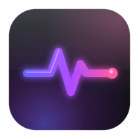

<p align="center">
  
</p>

<h1 align="center">api.live</h1>

<p align="center">
  <b>The local-first API workbench — a built-in API simulator and a Rust load engine.</b><br>
  No account. No cloud. Zero telemetry. Your requests are plain YAML in your repo.
</p>

<p align="center">
  <a href="https://github.com/apilivehq/apilive/releases/latest"></a>
  <a href="https://github.com/apilivehq/apilive/releases"></a>
  <a href="LICENSE.md"></a>
  
  
</p>

<p align="center">
  <a href="https://github.com/apilivehq/apilive/releases/latest/download/api.live_0.1.0_universal.dmg"><b>⬇&nbsp; Download for macOS</b></a>
  &nbsp;·&nbsp;
  <a href="#install-the-cli"><b>Install the CLI</b></a>
  &nbsp;·&nbsp;
  <a href="#use-it-as-an-mcp-server"><b>Use as MCP server</b></a>
  &nbsp;·&nbsp;
  <a href="https://api.live"><b>Website</b></a>
</p>

---

This repository hosts the **downloads, release notes and issue tracker** for api.live. It contains no
source code. api.live is free to use (see [LICENSE.md](LICENSE.md)).

## Download

Everything below comes from the **[latest release](https://github.com/apilivehq/apilive/releases/latest)**.
The macOS app is signed with an Apple Developer ID and notarized by Apple — it opens with a normal
double-click, no warning.

### 🖥️ Desktop app

| Platform | Download |
|---|---|
| **macOS** · Apple silicon + Intel (universal) | [**⬇ `.dmg`**](https://github.com/apilivehq/apilive/releases/latest/download/api.live_0.1.0_universal.dmg) |
| **Windows** · x64 | [`.exe` setup](https://github.com/apilivehq/apilive/releases/latest) · [`.msi`](https://github.com/apilivehq/apilive/releases/latest) |
| **Linux** · x64 | [`.deb`](https://github.com/apilivehq/apilive/releases/latest) · [`.AppImage`](https://github.com/apilivehq/apilive/releases/latest) |

### ⌨️ CLI (one `api` binary — includes the MCP server)

| Platform | Download |
|---|---|
| macOS · Apple silicon | [**⬇ `api-darwin-arm64.tar.gz`**](https://github.com/apilivehq/apilive/releases/latest/download/api-darwin-arm64.tar.gz) |
| macOS · Intel | [**⬇ `api-darwin-x64.tar.gz`**](https://github.com/apilivehq/apilive/releases/latest/download/api-darwin-x64.tar.gz) |
| Windows · x64 | [**⬇ `api-windows-x64.zip`**](https://github.com/apilivehq/apilive/releases/latest/download/api-windows-x64.zip) |
| Linux · x64 | [**⬇ `api-linux-x64.tar.gz`**](https://github.com/apilivehq/apilive/releases/latest/download/api-linux-x64.tar.gz) |
| Linux · arm64 | [**⬇ `api-linux-arm64.tar.gz`**](https://github.com/apilivehq/apilive/releases/latest/download/api-linux-arm64.tar.gz) |

### 📦 Extras

| | Download |
|---|---|
| Demo workspace (Shop Checkout API) | [**⬇ `demo-storefront.zip`**](https://github.com/apilivehq/apilive/releases/latest/download/demo-storefront.zip) |
| Checksums | [`SHA256SUMS.txt`](https://github.com/apilivehq/apilive/releases/latest/download/SHA256SUMS.txt) (and a `.sha256` next to every file) |

Every file has a `.sha256` next to it, and `SHA256SUMS.txt` lists them all. Check a download
before you run it:

- macOS: `shasum -a 256 -c SHA256SUMS.txt --ignore-missing`
- Linux: `sha256sum -c SHA256SUMS.txt --ignore-missing`
- Windows (PowerShell): `Get-FileHash .\api.live_<version>_x64-setup.exe` and compare the hash with
  the line in `SHA256SUMS.txt`

The **macOS app is signed and notarized by Apple**. The Windows installers are not code-signed yet,
so Windows asks once before the first launch (below).

## Install the app

### macOS

1. Open the `.dmg` and drag **api.live** to **Applications**.
2. Double-click **api.live** to launch — that's it. The app is signed with an Apple Developer ID and
   notarized by Apple, so macOS opens it without a warning.

### Windows

- **Setup `.exe`** (recommended): installs for your user, no admin rights needed, adds a Start menu
  entry. Uninstall from **Settings → Apps**.
- **`.msi`**: installs for all users under `Program Files` (asks for admin).

The installers are not code-signed yet. Your browser may say the file "isn't commonly downloaded":
choose **Keep**. Then SmartScreen shows "Windows protected your PC": **More info → Run anyway**.

### Linux

- **.deb** (Ubuntu 22.04+, Debian 12+ and derivatives):
  `sudo apt install ./api.live_<version>_amd64.deb`, then start **api.live** from the app menu or run
  `apilive-desktop`. Remove with `sudo apt remove api-live`.
- **AppImage** (other distributions): `chmod +x api.live_<version>_amd64.AppImage` and run it.
  AppImages need FUSE 2 (`sudo apt install libfuse2`, `libfuse2t64` on Ubuntu 24.04); without it run
  `./api.live_<version>_amd64.AppImage --appimage-extract-and-run`.

There is no signing prompt on Linux. The desktop packages do not include the `api` CLI; install it
separately (below).

## Install the CLI

The CLI is one binary, `api`. Each archive holds `api` (`api.exe` on Windows), `LICENSE.md` and
`THIRD-PARTY-NOTICES.md`.

macOS:

```bash
# Apple silicon (use api-darwin-x64.tar.gz on an Intel Mac)
curl -fLO https://github.com/apilivehq/apilive/releases/latest/download/api-darwin-arm64.tar.gz
tar xzf api-darwin-arm64.tar.gz
sudo mv api /usr/local/bin/
api --version
```

Downloaded with `curl`, the binary is not quarantined. If you downloaded the tarball with a browser
and macOS refuses to run `api`, run `xattr -d com.apple.quarantine /usr/local/bin/api`.

Linux:

```bash
# x64 (use api-linux-arm64.tar.gz on arm64)
curl -fLO https://github.com/apilivehq/apilive/releases/latest/download/api-linux-x64.tar.gz
tar xzf api-linux-x64.tar.gz
sudo mv api /usr/local/bin/
api --version
```

Windows (PowerShell):

```powershell
curl.exe -fLO https://github.com/apilivehq/apilive/releases/latest/download/api-windows-x64.zip
Expand-Archive api-windows-x64.zip -DestinationPath "$env:LOCALAPPDATA\api.live-cli"
# add that folder to your PATH (Settings → System → About → Advanced system settings →
# Environment Variables), open a new terminal, then:
api --version
```

## Use it as an MCP server

The MCP server is built into the CLI — installing `api` (above) is all you need. `api mcp` starts a
Model Context Protocol server over stdio that gives an AI agent 61 tools to run requests, run saved
load tests, read Last Known Good, discover APIs in a codebase, design the OpenAPI spec and run the
simulator.

Point your agent at it by adding this to its MCP config (the `api` binary must be on your `PATH`):

```json
{
  "mcpServers": {
    "apilive": {
      "command": "api",
      "args": ["mcp"]
    }
  }
}
```

- **Claude Desktop / Claude Code:** add the block above to the MCP settings (Claude Code:
  `claude mcp add apilive -- api mcp`).
- **Cursor / Windsurf:** add the same block to the editor's MCP configuration.

Run `api mcp --help` for transport and logging options. Nothing leaves your machine except the
requests you ask it to send.

## System requirements

- **macOS** 11 Big Sur or later, Apple silicon or Intel (tested on macOS 14 Sonoma).
- **Windows** 10 or 11, x64, with the Microsoft Edge WebView2 runtime (built into Windows 11 and
  current Windows 10; the setup installs it if it is missing, which needs an internet connection).
- **Linux** x64 with glibc 2.34 or later and WebKitGTK 4.1 (for example Ubuntu 22.04+ or Debian 12+).
  The CLI also runs on arm64 Linux.
- Disk: about 30 MB per architecture for the app (the universal macOS app holds both, about 70 MB;
  the AppImage bundles its libraries, about 95 MB). The CLI is about 30 MB.
- Optional: Node.js or Bun on your `PATH` for request scripts; Git if you want to version your workspace.

## Quick start with the demo API

The demo workspace is a small checkout API: an OpenAPI spec, a simulator service that answers it,
saved requests and an end-to-end flow (log in → cart → order → refund).

```bash
curl -fLO https://github.com/apilivehq/apilive/releases/latest/download/demo-storefront.zip
unzip demo-storefront.zip && cd checkout

api mock --list          # the "Shop Checkout API" simulator service
api mock                 # start it (http://127.0.0.1:4010/v2); leave it running

# in a second terminal, same folder:
api flow run checkout    # the end-to-end flow against the simulator
```

In the app: **File → Open Workspace…** (⌘O; Ctrl+O on Windows and Linux), pick the `checkout`
folder, then start the simulator from the Simulator screen and press ⌘↵ (Ctrl+Enter) on any request.
⌘/ (Ctrl+/) lists every shortcut.

On your own project: `api init .` creates `.apilive/` in your repo, and `api index` finds the
endpoints in your codebase. `api --help` lists every command.

## Docs and help

- Website: https://api.live
- In the app: **Help** menu, and ⌘/ (Ctrl+/) for shortcuts. **Help → Copy Diagnostics** copies versions and
  workspace counts for a bug report (never values or secrets).
- CLI: `api --help`, `api <command> --help`
- Release notes: [CHANGELOG.md](CHANGELOG.md)

## Report a bug or ask for a feature

[Open an issue](https://github.com/apilivehq/apilive/issues/new/choose). Security problems: please
do **not** open a public issue; see [SECURITY.md](SECURITY.md).

## Privacy

api.live has no account, no cloud and no telemetry. It talks only to the hosts you send requests to
and the integrations you configure.

## License

Free to use, including commercially; all rights reserved. See [LICENSE.md](LICENSE.md). Bundled
open-source components and their licenses: `THIRD-PARTY-NOTICES.md` in the app and in each CLI archive.
